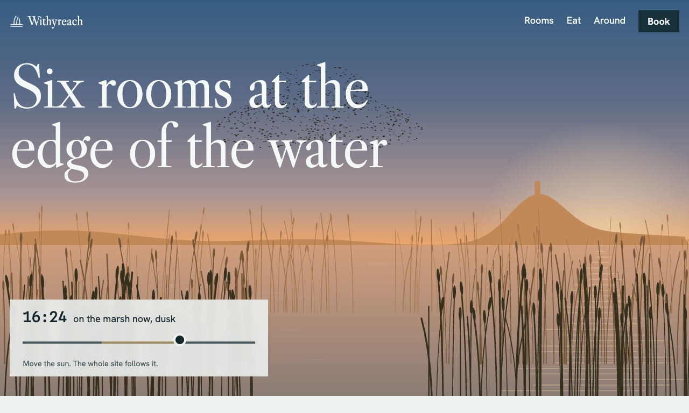
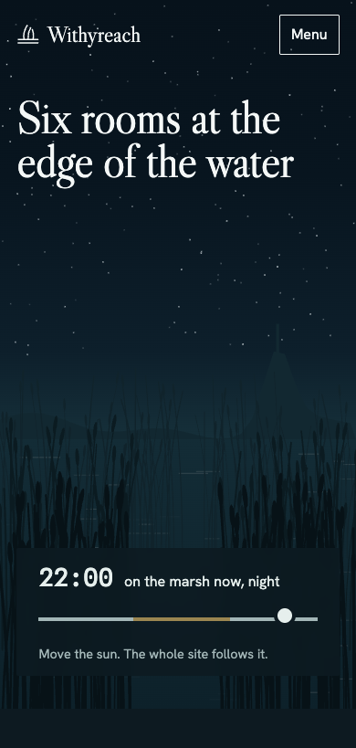
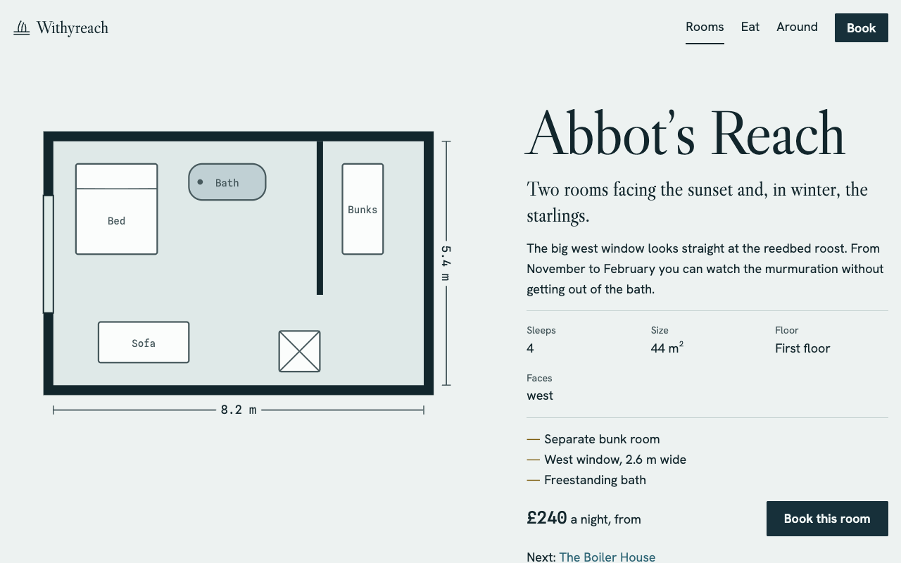

# Withyreach Hotel

[](https://github.com/Atharv1414/withyreach-hotel/actions/workflows/ci.yml) **[See it live](https://atharv1414.github.io/withyreach-hotel/)**

A design-led website for a fictional six-room hotel on the Somerset Levels, in React, SCSS and JavaScript. No template, no component library, no stock photos.

[](https://atharv1414.github.io/withyreach-hotel/)

## The idea

People come to the Levels for the light and the winter starlings, so **the page keeps the real hour on the marsh**. The sun's position over the hotel is calculated from the date and time, and the sky, the water, the page colours and the light or dark theme all follow it. Move the sun with the slider and the whole site moves through dawn, day, dusk and night. Around sunset the starlings gather.

| Phone, at night | A room, drawn to scale |
|---|---|
|  |  |

## What is in it

- **A canvas scene**: sky, sun, water, three layers of reeds and 900 starlings, drawn from the hour. It stops drawing when scrolled away and holds still for people who ask for reduced motion.
- **Room plans drawn from data**: every plan is an SVG built from the room's measurements in metres. The home page shows three at one shared scale. Tests check that the furniture fits, does not overlap, and matches the stated features.
- **A booking flow with no date library**: a keyboard-operable calendar, availability rules (a taken night can be a departure day but never slept through), nightly prices, extras, validation, and a draft that survives a reload without storing anyone's details.
- **SCSS architecture**: seven layers, design tokens as custom properties, and functions for fluid type and spacing that fail the build on an unknown step.
- **Filters in the address**, deep links that work on static hosting, and focus that moves with client-side navigation.

## Quality checks

| Check | Covers |
|---|---|
| 42 unit and component tests | Sun times against almanac values, legibility of the navigation and heading at every sun height, date arithmetic across clock changes, prices, availability, calendar keyboard behaviour, booking from start to finish |
| 14 browser tests (desktop and phone) | axe accessibility checks on all pages by day, dusk and night; no sideways scrolling; no flash of the wrong theme; keyboard-only booking; deep links after a reload |
| ESLint and Stylelint | Both clean |

The browser tests found real faults while I built this, now fixed: a list used as a tab panel, calendar buttons whose spoken name did not match their text, and a white heading that lost contrast just after sunset.

## Limits

- The hotel is invented, and so is its availability (a hash of room and date). Nothing is booked, paid or sent.
- The sun is accurate to well under a degree. The scene around it is a drawing, not a forecast.
- The colour behind the hero text is checked in a unit test, because an accessibility checker cannot see through a canvas.

## Run it

```bash
npm install
npm run dev
npm test
npm run lint
npx playwright install chromium && npm run e2e
```

```
src/lib/         sun, sky, dates, booking: plain functions, no React
src/state/       the hour the site is showing
src/components/  scene, dial, plan, calendar, header, footer
src/pages/       one file per page
src/styles/      abstracts, base, layout, components, pages
```

MIT licence. Fonts: Libre Caslon Display, Hanken Grotesk, Spline Sans Mono (SIL Open Font Licence).
